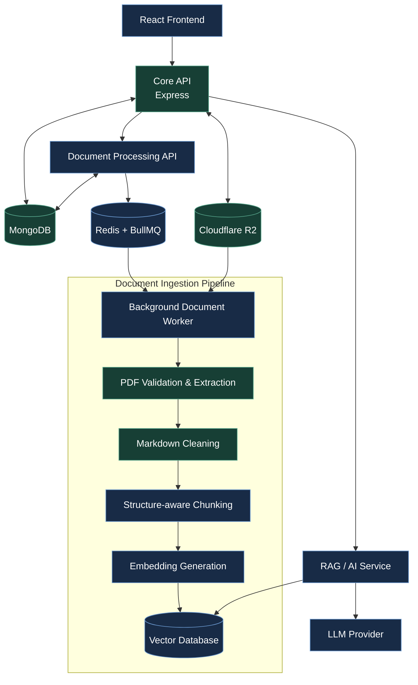
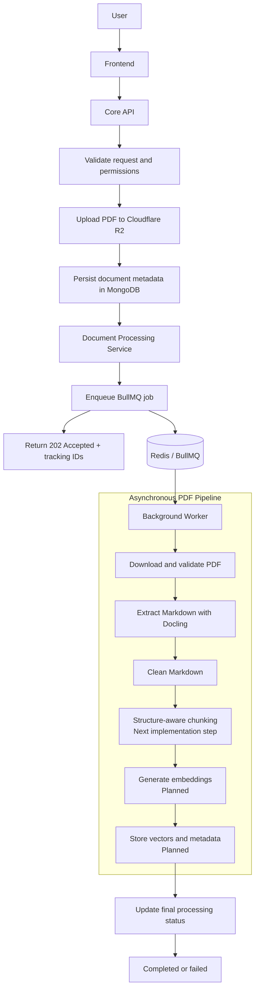
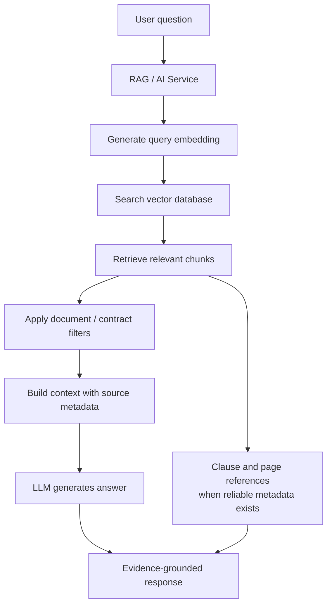
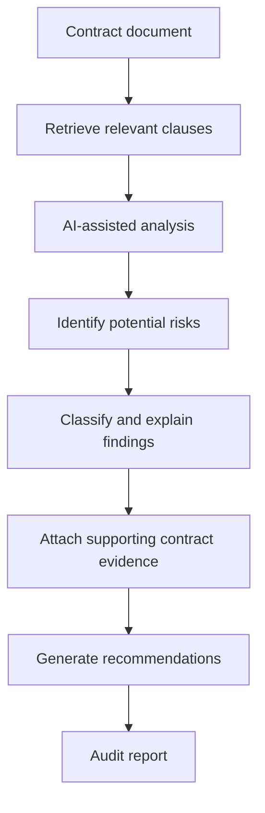

# ClauseNexa

**An AI-powered legal contract analysis platform built for structured
document processing, evidence-grounded retrieval, and contract risk
analysis.**

> **Project status:** Active development --- Core API and document
> management foundation implemented; document-processing pipeline in
> progress.

ClauseNexa is a production-oriented engineering project focused on
processing complex legal documents and making their contents easier to
search, understand, and analyze. Its planned pipeline combines
asynchronous processing, object storage, structure-aware text chunking,
vector search, and Retrieval-Augmented Generation (RAG).

## Table of Contents

-   [Problem Statement](#problem-statement)
-   [Project Goals](#project-goals)
-   [Architecture](#architecture)
-   [Document Processing Workflow](#document-processing-workflow)
-   [Document Management](#document-management)
-   [Processing States](#processing-states)
-   [Document Versioning](#document-versioning)
-   [Planned RAG and Contract Audit](#planned-rag-and-contract-audit)
-   [Technology Stack](#technology-stack)
-   [Repository Structure](#repository-structure)
-   [Testing](#testing)
-   [Development Roadmap](#development-roadmap)
-   [Architecture Documentation](#architecture-documentation)
-   [Engineering Focus](#engineering-focus)
-   [Project Status](#project-status)
-   [Author](#author)

## Problem Statement

Legal contracts can contain hundreds of pages of clauses, obligations,
liabilities, exceptions, and conditions. Manually reviewing them is
time-consuming, and overlooking a qualification or related clause can
lead to an incomplete understanding.

ClauseNexa aims to address the engineering challenges of large-document
processing with asynchronous jobs, reliable document lifecycle
management, searchable document representations, and AI-assisted
analysis grounded in retrieved evidence.

## Project Goals

-   Upload and manage legal contract documents.
-   Process large PDF documents asynchronously.
-   Extract and clean document text.
-   Chunk text while preserving legal structure and context.
-   Generate and store vector embeddings.
-   Retrieve relevant clauses and document sections.
-   Support contextual, evidence-grounded contract Q&A.
-   Provide clause and page references where reliable source information
    is available.
-   Support automated contract risk analysis.
-   Track document processing state and processing versions.
-   Keep service responsibilities clearly separated and independently
    scalable.

## Architecture

The intended architecture separates the core product API, document
ingestion pipeline, and RAG/AI functionality.



### Core API -

Responsible for:

-   Authentication and authorization
-   User and contract management
-   Document management and PDF upload handling
-   Cloudflare R2 integration
-   Document metadata and lifecycle management
-   Invoking the Document Processing Service
-   Returning document and processing status

The Core API is not intended to perform heavy PDF processing or
construct AI context synchronously.

### Document Processing Service -

Responsible for:

-   Creating document-processing jobs
-   BullMQ queue and background-worker orchestration
-   PDF download and extraction
-   Extracted Markdown cleaning
-   Structure-aware document chunking
-   Embedding generation
-   Vector database storage
-   Processing status and error updates

### RAG / AI Service -

Planned responsibilities:

-   Query embedding
-   Vector retrieval and metadata filtering
-   Contract-aware context construction
-   Prompt construction
-   LLM interaction
-   Contract Q&A
-   Contract audit analysis and evidence presentation

## Document Processing Workflow

Document ingestion is designed to be asynchronous. The request path
should not wait for a complete document-processing job.



A successful job-enqueue request can return a response shaped like:

``` json
{
  "documentId": "...",
  "jobId": "...",
  "processingStatus": "queued"
}
```

The exact response depends on the implemented API contract.

## Document Management

### API endpoints

``` text
POST   /api/v1/contracts/:contractId/documents
GET    /api/v1/contracts/:contractId/documents
GET    /api/v1/documents/:documentId
DELETE /api/v1/documents/:documentId
```

### Current capabilities

-   PDF-only upload
-   25 MB upload limit
-   300 pages page limit
-   Cloudflare R2 object storage integration
-   SHA-256 file hashing
-   Duplicate-document detection
-   Document metadata persistence
-   Processing-job integration and state tracking
-   Soft deletion
-   Active-document handling
-   Document ownership validation
-   Contract ownership validation

## Processing States

The intended successful processing lifecycle is:

``` text
queued
  |
  v
processing
  |
  v
extracting
  |
  v
chunking
  |
  v
embedding
  |
  v
storing_vectors
  |
  v
completed
```

Failures should be represented explicitly, including a `failed`
processing status and a useful processing error.

Progress and stage values must reflect work that has actually completed;
a document should not be marked `completed` while required pipeline
stages remain unimplemented or unsuccessful.

## Document Versioning

ClauseNexa treats uploaded files as independent document versions.

Document-level fields:

``` text
processingVersion
activeProcessingVersion
```

Contract-level field:

``` text
activeDocumentId
```

A new upload should not replace the currently active document before the
new version has been processed successfully.

``` text
Before processing:
Contract
  └── activeDocumentId -> Document A

While a new upload is processing:
Contract
  ├── activeDocumentId -> Document A
  └── Document B -> processing

If Document B fails:
  └── Document A remains active

If Document B succeeds:
  └── Document B can become active
```

This design helps prevent an unsuccessful processing run from replacing
a working document version.

## Planned RAG and Contract Audit

### Contract Q&A



Responses are intended to provide supporting evidence, including
relevant contract sections, clause identifiers, and page references when
reliable metadata is available. The system should distinguish retrieved
contract text from generated interpretation and should not invent
citations.

### Automated contract audit



Potential areas for analysis include:

-   Missing or incomplete clauses
-   Risky or ambiguous language
-   Termination provisions
-   Payment obligations
-   Liability limitations
-   Indemnification
-   Confidentiality
-   Intellectual property
-   Non-compete and non-solicitation provisions
-   Governing law and jurisdiction

A finding is intended to include a risk level, explanation, supporting
evidence, source reference, and recommendation. ClauseNexa is an
engineering project, not a substitute for advice from a qualified legal
professional.

## Technology Stack

### Current backend foundation

-   Node.js
-   Express.js
-   MongoDB and Mongoose
-   Cloudflare R2
-   Multer
-   Jest

### Processing and AI infrastructure

Planned or being integrated:

-   Redis
-   BullMQ
-   Docker
-   Vector database
-   Embedding model/provider
-   LLM provider
-   PDF extraction through Docling

### Planned frontend

-   React
-   TypeScript
-   Tailwind CSS

## Repository Structure

The intended high-level layout is:

``` text
ClauseNexa/
├── backend/
│   ├── core-api/
│   ├── document-processing/
│   └── rag-service/
├── client/
├── docs/
│   ├── architecture/
│   └── diagrams/
├── README.md
└── .gitignore
```

The exact contents may evolve as the services are implemented.

## Testing

Testing is being developed alongside the backend.

The existing Document Controller test suite has been reported as **29
tests passing**. Coverage includes:

-   Invalid IDs and missing files
-   Contract ownership checks
-   Duplicate uploads
-   Successful uploads
-   R2 failures
-   Database failures
-   Processing-service failures
-   Cleanup failures
-   Document retrieval and empty collections
-   Soft deletion
-   Active-document deletion
-   Database error paths

Additional service, worker, pipeline, and integration tests should be
added as those components are implemented. Re-run the test suite before
relying on the reported count.

## Development Roadmap

### Weeks 1--3 --- Core Backend

-   [x] Project definition and requirements
-   [x] High-Level Design and service boundaries
-   [x] Low-Level Design
-   [x] Repository setup
-   [x] Authentication and authorization
-   [x] User management
-   [x] Contract management
-   [x] Document management
-   [x] PDF upload and Cloudflare R2 integration
-   [x] Duplicate-document detection
-   [x] Document soft deletion
-   [x] Document-processing integration point
-   [x] Document controller tests

### Week 4 --- Document Processing Service

-   [x] Document Processing Service
-   [x] Redis and BullMQ integration
-   [x] Job producer and background worker
-   [x] Processing service API
-   [x] Job retry strategy
-   [x] Processing service tests

### Week 5 --- PDF Processing Pipeline

-   [x] PDF extraction integration
-   [x] Markdown cleaning utility
-   [ ] Structure-aware document chunking
-   [ ] Chunk metadata
-   [ ] Complete processing-stage updates
-   [ ] Failure handling and retry support

### Week 6 --- Embeddings and Vector Database

-   [ ] Embedding generation
-   [ ] Vector database integration
-   [ ] Vector indexing
-   [ ] Metadata filtering
-   [ ] Processing-version handling
-   [ ] Active-document activation after successful processing

### Week 7 --- RAG Service

-   [ ] RAG Service
-   [ ] Query embeddings
-   [ ] Semantic retrieval
-   [ ] Contract-aware retrieval
-   [ ] Prompt construction
-   [ ] LLM integration
-   [ ] Citation handling
-   [ ] AI Q&A tests

### Week 8 --- AI Audit and Backend Hardening

-   [ ] Automated contract audit engine
-   [ ] Risk classification
-   [ ] Evidence extraction
-   [ ] Recommendations
-   [ ] Backend integration testing
-   [ ] Security hardening
-   [ ] Reliability improvements
-   [ ] Production-readiness review

**Backend milestone:** The backend should be usable independently of the
frontend.

### Week 9 --- Frontend Core

-   [ ] React application
-   [ ] Authentication UI
-   [ ] Dashboard
-   [ ] Contract management UI
-   [ ] Document upload
-   [ ] Processing status
-   [ ] Contract workspace

### Week 10 --- Frontend AI and UX

-   [ ] AI chat
-   [ ] Citation UI
-   [ ] Audit report UI
-   [ ] Risk visualization
-   [ ] Loading and error states
-   [ ] Responsive UI
-   [ ] UX polish

### Week 11 --- Beta Testing

-   [ ] End-to-end testing
-   [ ] Large-PDF testing
-   [ ] Concurrent-processing testing
-   [ ] AI response and RAG accuracy testing
-   [ ] Security and performance testing
-   [ ] Bug fixing and regression testing

### Week 12 --- Deployment

-   [ ] Production infrastructure
-   [ ] Environment configuration
-   [ ] Core API deployment
-   [ ] Document Processing deployment
-   [ ] RAG service deployment
-   [ ] Database, Redis, and vector database deployment
-   [ ] Frontend deployment
-   [ ] Domain and HTTPS
-   [ ] Production verification and release

The roadmap is a plan; unchecked items are not represented as completed
functionality.

## Architecture Documentation

Current architecture documentation includes:

-   High-Level Design
-   Service communication and data flow
-   Low-Level Design

These documents describe service responsibilities, communication
boundaries, data ownership, and processing architecture.

## Engineering Focus

ClauseNexa is being developed to explore and demonstrate:

-   Backend architecture and REST API design
-   Asynchronous processing and distributed systems
-   Queue-based workloads and background workers
-   Object storage and document lifecycle management
-   Structure-aware text processing
-   Vector databases and Retrieval-Augmented Generation
-   LLM integration and evidence-grounded responses
-   Service boundaries and data consistency
-   Document versioning and fault tolerance
-   Testing, security, scalability, and deployment

## Project Status

ClauseNexa is under active development. The Core API foundation and
document-management functionality have been implemented. PDF extraction
and Markdown cleaning are integrated into the processing workflow;
structure-aware chunking, embeddings, vector storage, RAG, the audit
engine, frontend, and deployment remain planned or in progress.

This project is currently intended for educational and portfolio
purposes.

## Author

**Ayush Narayan Gupta**

Built as part of the **Zero to FAANG** engineering journey.
